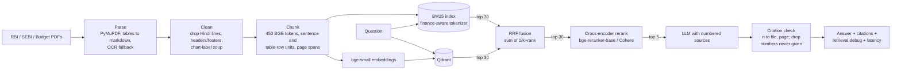

# Hybrid Search RAG over Indian finance PDFs

    

Question answering over RBI, SEBI and Union Budget PDFs that combines **keyword search (BM25)**
with **semantic search (vectors)**, merges them with **Reciprocal Rank Fusion**, re-scores with a
**cross-encoder**, and answers with a **citation to the document and page** for every claim, or
says it couldn't find the answer. Every retrieval choice is measured on a hand-reviewed golden set.

**Live demo:** _coming soon (Hugging Face Spaces)_ · **2-minute walkthrough:** _coming soon_

## The problem: why plain vector RAG struggles here

Regulatory text mixes two kinds of questions:

- **Exact terms**: "What does circular `SEBI/HO/IMD/DF2/CIR/P/2021/668` say?", "section `148A`",
  "Form `26AS`". An embedding model reads a circular number as "some SEBI circular"; bge's
  tokenizer even splits `26AS` into `26` + `##as`. In our probes, vector search put **0 of 5**
  chunks containing that circular number in its top 5. BM25 put **4 of 5**.
- **Paraphrases**: "How much will the government borrow relative to the size of the economy?" The
  Budget speech says "debt-to-GDP ratio", sharing no words with the question. Vector search
  ranked the right chunk **#1**; BM25 found nothing.

Each retriever fails where the other succeeds, so this project fuses them and measures whether
the fusion (and a reranker on top) actually helps.

## Architecture



| Stage | Choice | Code |
|---|---|---|
| Parse | PyMuPDF with `find_tables()` to markdown, Tesseract OCR for image-only pages | [parse.py](src/hybrid_rag/ingestion/parse.py) |
| Clean | Non-ASCII-letter filter per line (catches Unicode and legacy-font Hindi), digit-masked running headers, chart-label removal | [clean.py](src/hybrid_rag/ingestion/clean.py) |
| Chunk | 450 BGE tokens, 64 overlap; sentences and table row-groups with the header row repeated; headings start chunks | [chunk.py](src/hybrid_rag/ingestion/chunk.py) |
| Dense | `BAAI/bge-small-en-v1.5` via fastembed (ONNX, no PyTorch), cosine in Qdrant | [embed.py](src/hybrid_rag/indexing/embed.py) |
| Keyword | `rank_bm25` with a tokenizer that keeps `10(23C)`, `148A(d)`, circular numbers whole | [bm25_index.py](src/hybrid_rag/indexing/bm25_index.py) |
| Fusion | Reciprocal Rank Fusion, our own 8 lines | [fusion.py](src/hybrid_rag/retrieval/fusion.py) |
| Rerank | `BAAI/bge-reranker-base` (local) or Cohere Rerank, top 30 to top 5 | [rerank.py](src/hybrid_rag/retrieval/rerank.py) |
| Answer | Ollama / OpenAI / Anthropic / Gemini; cite-by-number, validated | [answer.py](src/hybrid_rag/generation/answer.py) |

## Results

Golden set v1: **74 questions** over 27 documents (64 answerable: 16 exact-term, 18 paraphrase,
22 numeric, 8 multi-hop; plus 10 unanswerable near-misses). 46 were drafted by llama3.1 and then
reviewed against the source pages (43 needed edits, 24 more drafts were dropped); 28 were written
from the page text. **All review so far was done by Claude, not yet by a human**: see
`reviewer` in [golden_set.jsonl](eval/golden_set.jsonl). Numbers are copied from
`eval/results/` reports, never typed by hand.

Retrieval, 64 answerable questions, top 10 ([report](eval/results/20261026-1708-v1-fast.md)):

| Mode | Recall@5 | Recall@10 | MRR | nDCG@10 | p95 retrieval |
|---|---|---|---|---|---|
| Vector only (bge-small) | 0.625 | 0.750 | 0.499 | 0.551 | 86 ms |
| **BM25 only** | **0.859** | **0.914** | **0.665** | **0.721** | 140 ms |
| Hybrid (RRF, k=60) | 0.789 | 0.844 | 0.631 | 0.679 | 202 ms |
| Hybrid + rerank | _running_ | | | | |

Recall@5 by question type:

| Mode | exact_term (16) | paraphrase (18) | numeric (22) | multi_hop (8) |
|---|---|---|---|---|
| Vector only | 0.750 | 0.500 | 0.727 | 0.375 |
| BM25 only | **1.000** | **0.722** | **0.955** | **0.625** |
| Hybrid (RRF, k=60) | 0.875 | 0.667 | 0.909 | 0.562 |

**What this shows, honestly:** on this corpus and question set, BM25 beats dense retrieval on
every question type, including paraphrases, and RRF fusion with the weaker dense list pulls BM25
*down*. The RRF sweep (k 5 to 60 x depth 10 to 30) improves hybrid only to Recall@5 0.820 (k=5,
depth 20), still below BM25. Why the dense side is weak (from the per-question CSVs): for Budget
questions its top hits are number tables from Budget at a Glance and the Receipt Budget rather
than the speech paragraph with the answer; every chunk is embedded with its document title, so a
question mentioning "Budget 2026-27" is close to all of them, and table chunks that are mostly
digits sit near any finance question. Caveats: 64 questions means roughly +/-5 points of noise
per figure, and questions drafted from passages share wording with them, which favours BM25.

**How it's measured** ([metrics.py](eval/metrics.py)): relevance is labelled as `(document,
pages)`, not chunk ids, so the same golden set scores any chunk size. A retrieved chunk counts if
its page span overlaps a labelled page. Recall@k = share of required passages in the top k (two
for multi-hop questions); MRR = 1/rank of the first hit; nDCG@10 credits each passage once at the
rank it first appears. Generation adds citation accuracy, refusal accuracy on unanswerable
questions, false refusals, and p50/p95 latency per stage.

## Design decisions and trade-offs

- **RRF, not weighted score sums.** BM25 scores run 0 to 30+ and vary with query length; cosine
  similarities here sit between about 0.6 and 0.8. Ranks are comparable by construction, so RRF
  needs no per-query normalisation. Caveat we hit: with `k = 60` and 30-deep lists, a chunk ranked
  26th and 15th (score 0.025) outranks one ranked 1st by a single retriever (0.016). On the
  circular-number probe, BM25's correct ranks 1 to 5 became RRF ranks 10 to 17. `eval/run_eval.py
  --sweep` tests `k` and fusion depth on the golden set instead of trusting the default.
- **Cross-encoder reranking on 30 candidates.** The embedder encodes question and chunk
  separately (fast, approximate). The cross-encoder reads them together (slow, precise). On our
  probes it restored the circular-number chunks to ranks 1 to 5 and found the right chunk first on
  4 of 5 queries. Cost: about 15 s per query for 30 chunks of ~470 tokens on a laptop CPU, far
  from the "under a second" often quoted for short passages. `jina-reranker-v1-turbo-en` is ~4x
  faster but weaker on exact terms. Cohere Rerank removes the cost for the hosted demo.
- **450-token chunks, not 512 or 1024.** bge models truncate at 512 tokens, so a 1024-token chunk
  is mostly never embedded. 450 leaves room for the "title / section" prefix each chunk is
  embedded with.
- **Cite by number, then validate.** The LLM sees sources `[1]` to `[5]` and cites numbers;
  code maps them to `[file.pdf, p.X]` and drops any number it never received. Asking a model to
  reproduce file names invites typos, while a number is easy to emit and to check.
- **No LangChain / LlamaIndex.** Retrieval, fusion, prompting and citation checks are plain
  Python so every step can be inspected and tested.
- **Embedded Qdrant + fastembed.** The index is ~25 MB and the models run on ONNX, so the demo is
  one container with no external database and no PyTorch. `QDRANT_URL` switches to a Qdrant
  server or Qdrant Cloud without code changes.

## Quickstart

```bash
git clone <this repo> && cd hybrid-search-rag
uv sync
cp .env.example .env                              # defaults: embedded Qdrant + local Ollama
uv run python scripts/download_data.py            # PDFs listed in data/sources.csv
uv run python -m hybrid_rag.ingestion.pipeline    # PDFs -> pages.jsonl -> chunks.jsonl
uv run python -m hybrid_rag.indexing.build        # BM25 (~1 s) + vectors (~7 min on CPU)
ollama pull llama3.1                              # or set LLM_PROVIDER / LLM_MODEL / key in .env
uv run python -m hybrid_rag.cli "What is the debt-to-GDP ratio estimated for 2026-27?"
```

`--mode vector|bm25|hybrid|hybrid_rerank` picks the retriever; `--retrieve-only` prints the
ranking table without calling the LLM. RBI's site serves a bot challenge to scripts, so its three
PDFs must be saved by hand into `data/raw/` (the download script tells you which).

Make targets: `make data ingest index ask Q="..." serve ui eval eval-full test lint`.

## API

```bash
uv run uvicorn hybrid_rag.api.main:app --port 8000      # docs at http://localhost:8000/docs
uv run streamlit run ui/app.py                          # UI at http://localhost:8501
```

```bash
curl -X POST localhost:8000/query -H "Content-Type: application/json" -d '{"question": "What is the TCS rate on remittances under the Liberalised Remittance Scheme for education?", "mode": "hybrid"}'
```

A real response (snippet shortened):

```json
{
  "answer": "According to [budget_2026_27_memorandum_finance_bill.pdf, p.50], the TCS rate on remittances made under the Liberalised Remittance Scheme for education is proposed to be reduced to 2% if the remittance amount exceeds ten lakh rupees.",
  "refused": false,
  "citations": [
    {"doc": "budget_2026_27_memorandum_finance_bill.pdf", "page": "p.50",
     "chunk_id": "budget_2026_27_memorandum_finance_bill:0069", "snippet": "..."}
  ],
  "invalid_citations": [],
  "uncited": false,
  "retrieval_debug": {"mode": "hybrid", "chunks": ["... vector_rank, bm25_rank, rrf_rank, rerank_score per context chunk"]},
  "latency_ms": {"retrieve": 23, "generate": 54433, "total": 54455}
}
```

| Endpoint | What it does |
|---|---|
| `POST /query` | Question + mode -> cited answer. 422 on bad input, 429 over the per-IP rate limit, 503 if the LLM is unreachable |
| `GET /health` | Indexed chunk count, configured LLM and reranker |
| `POST /ingest` | Rebuild everything from `data/raw` in the background. Needs `X-Admin-Token`; disabled unless `ADMIN_TOKEN` is set |

Every query logs one JSON line with per-stage latency, citation count and refusal.

Embedded Qdrant allows one process at a time: stop the API before running the CLI or eval, or
point everything at a Qdrant server with `QDRANT_URL`.

## Evaluation workflow

```bash
uv run python scripts/build_golden_set.py            # LLM drafts questions per type
uv run python scripts/review_golden_set.py           # keep / edit / drop each one (resumable)
uv run python scripts/review_golden_set.py --add     # write ~30% of questions by hand
uv run python scripts/review_golden_set.py --check   # validate labels against the corpus
uv run python eval/run_eval.py --sweep               # retrieval, all 4 modes + RRF sweep
uv run python eval/run_eval.py --generate            # + answers: citation / refusal accuracy
```

Drafting guards against weak questions (numeric answers must contain a number, exact-term
questions must contain an identifier, tables of contents and blank forms are skipped), but every
question is still reviewed by hand. Hand-written questions limit the bias of questions generated
from our own chunks.

## Docker and deployment

```bash
docker compose up --build app      # UI http://localhost:7860, API http://localhost:8000/docs
uv run python scripts/deploy_space.py --space <you>/hybrid-rag --dry-run    # what would ship
uv run python scripts/deploy_space.py --space <you>/hybrid-rag --var LLM_PROVIDER=gemini --var LLM_MODEL=<model>
```

One image runs the API and the Streamlit UI (`scripts/start.sh`); the embedding and reranker
models are downloaded at build time, and the prebuilt indexes are copied in, so the container
never parses PDFs. LLM API keys go in the Space's secrets, never in the repo.

## Failure cases found so far

- **RRF with k = 60 demoted single-retriever wins** (see design decisions); the eval sweep decides.
- **A valid citation on an unsupported claim**: llama3.1 called a circular "rescinded", citing a
  page that only lists it in a footnote. Citation checks can't catch this; faithfulness
  evaluation (RAGAS) can.
- **Charts lose their numbers.** Bar-chart labels in Budget at a Glance extract as unlabelled
  number soup, so they're dropped; values that exist only in charts are unanswerable.
- **LLM-drafted "paraphrase" questions reuse the passage's words**, which flatters BM25. Review
  rewrites them and hand-written questions balance the set.
- **Some table headers are junk**: a page title split across cells becomes the "header" repeated
  on each table piece.

## What's next

Experiments the v1 eval points to (run each on a held-out split so the golden set isn't tuned on):
embed chunks without the document-title prefix; keep number-only table chunks out of the dense
index (BM25 still covers them); a non-quantized or larger embedder (bge-base); weighted RRF that
trusts BM25 more. Then: query rewriting and HyDE for short questions; RAGAS faithfulness with a stronger judge model;
reading charts with a vision model; a fine-tuned or long-context embedder (bge-m3) to test larger
chunks; Hindi documents with a multilingual embedder; Qdrant sparse vectors to keep both indexes
in one database.

## Tech stack

Python 3.11 · uv · PyMuPDF · fastembed (bge-small-en-v1.5, bge-reranker-base) · rank_bm25 +
PyStemmer · Qdrant · Ollama / OpenAI / Anthropic / Gemini · FastAPI · Streamlit · Docker ·
pytest + ruff + GitHub Actions
